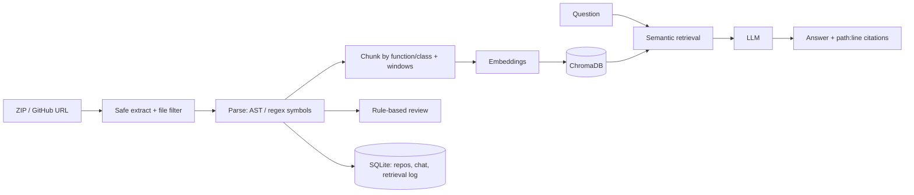

# CodeCompass
AI-powered codebase intelligence: upload a ZIP or paste a public GitHub URL, then explore the repo, ask questions with file/line citations (RAG), and get a code review.

## Architecture


## Run it
```bash
# backend (Python 3.10+)
cd backend && python -m venv .venv && source .venv/bin/activate
pip install -r requirements.txt
export ANTHROPIC_API_KEY=...        # optional; without it, chat shows retrieved sources only
uvicorn app.main:app --port 8000

# frontend (Node 18+), second terminal
cd frontend && npm install && npm run dev      # http://localhost:5173
```
Try it with `samples/demo_repo` (zip that folder and upload it).

## Tests
`cd backend && python -m pytest -q tests` (set `VECTOR_BACKEND=chroma` to exercise ChromaDB).

## What is and isn't implemented
- **Works (tested):** ZIP ingestion with zip-slip/size guards, GitHub URL validation, Python AST symbols, JS/TS/Go/Java regex symbols (approximate), chunking with line ranges, embeddings + ChromaDB/memory retrieval, citations, chat history, rule-based Python review, secret redaction and `.env`/key-file exclusion, retrieval logging + thumbs feedback.
- **Not tested in this build:** the LLM answer path and `sentence-transformers` embeddings (they need an API key / model download). Tests use the hashing fallback embedder, which is lexical only, so retrieval quality with it is weaker than with real embeddings.
- **Limitations:** review rules cover Python only; the relationship graph covers Python imports only; GitHub cloning needs `git` and a public repo; no auth, so run locally.
- **Quality tracking:** the Insights page shows average top similarity and your Yes/No votes. These are usage signals, not accuracy benchmarks. A labelled question set is a good next step.
- **Not included:** demo video.
