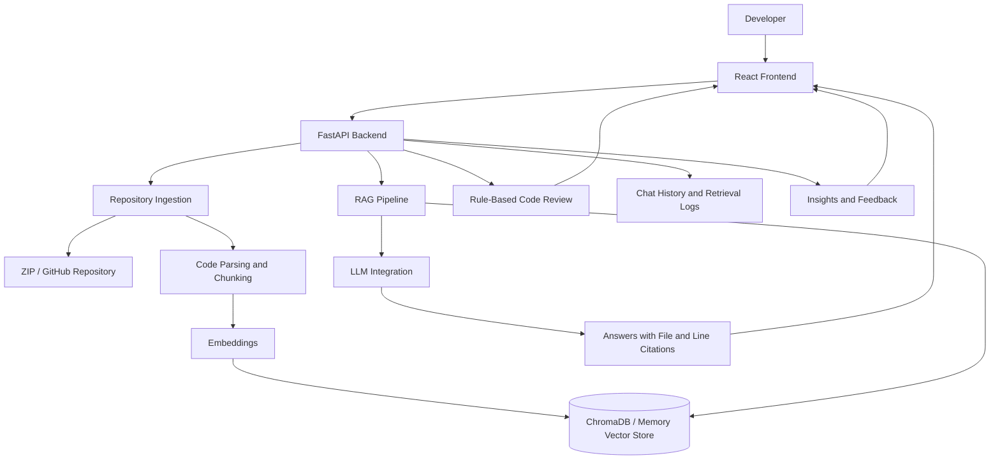

# CodeCompass – AI-Powered Codebase Intelligence

**Understand unfamiliar codebases faster with AI-powered repository exploration, Retrieval-Augmented Generation (RAG), and automated code review.**

CodeCompass is an AI-powered codebase intelligence tool that helps developers explore repositories, understand code, trace application logic, and identify potential issues.

Upload a repository as a ZIP file or provide a public GitHub repository URL to get started.

## Features

### 1. Repository Explorer
- Upload codebases through ZIP files or public GitHub URLs.
- Extract and organize repository files.
- Identify code symbols and relevant source locations.
- Explore repository structure.

### 2. RAG-Based Code Assistant
- Ask natural-language questions about an entire codebase.
- Retrieve relevant code chunks using embeddings and vector search.
- Generate answers grounded in retrieved repository content.
- Display file names and line-number citations to help verify answers.
- Maintain chat history.

### 3. Automated Code Review
- Analyze Python code using rule-based review checks.
- Identify potential code quality and implementation issues.
- Redact detected secrets from relevant outputs.

### 4. Insights Dashboard
- Track retrieval activity.
- View average top similarity scores.
- Collect Yes/No feedback on AI responses.
- Use feedback and retrieval signals to evaluate usage patterns.

## Architecture



## Technology Stack

| Component | Technologies |
|---|---|
| Frontend | React, Vite, JavaScript |
| Backend | Python, FastAPI |
| AI / LLM | Anthropic API (optional) |
| RAG | Retrieval-Augmented Generation |
| Vector Database | ChromaDB, In-Memory Store |
| Embeddings | Configurable embedding backends |
| Code Parsing | Python AST, Regex-based parsing |
| API Communication | REST APIs |

## Project Structure

```text
CodeCompass/
│
├── backend/
│   ├── app/
│   │   ├── main.py
│   │   ├── rag.py
│   │   ├── llm.py
│   │   ├── embeddings.py
│   │   ├── vectorstore.py
│   │   ├── parser.py
│   │   ├── chunker.py
│   │   ├── repo.py
│   │   ├── review.py
│   │   └── db.py
│   │
│   ├── tests/
│   └── requirements.txt
│
├── frontend/
│   ├── src/
│   │   ├── App.jsx
│   │   ├── api.js
│   │   └── styles.css
│   ├── package.json
│   └── vite.config.js
│
├── samples/
│   └── demo_repo/
│
├── .env.example
├── .gitignore
└── README.md
```

## Getting Started

### Prerequisites

- Python 3.10+
- Node.js 18+
- npm
- Git (required for public GitHub repository cloning)

### 1. Clone the repository

```bash
git clone https://github.com/akshatha010924/CodeCompass.git
cd CodeCompass
```

### 2. Set up the backend

Navigate to the backend directory:

```bash
cd backend
```

Create a virtual environment:

**Windows PowerShell:**

```powershell
python -m venv .venv
.\.venv\Scripts\python.exe -m pip install -r requirements.txt
```

**Linux / macOS:**

```bash
python3 -m venv .venv
source .venv/bin/activate
pip install -r requirements.txt
```

Configure the environment variables if needed. Refer to the root `.env.example` file.

For Anthropic API integration, configure your API key:

**Windows PowerShell:**

```powershell
$env:ANTHROPIC_API_KEY="your-api-key"
```

**Linux / macOS:**

```bash
export ANTHROPIC_API_KEY="your-api-key"
```

Start the backend:

```bash
python -m uvicorn app.main:app --port 8000
```

On Windows, if you did not activate the virtual environment, use:

```powershell
.\.venv\Scripts\python.exe -m uvicorn app.main:app --port 8000
```

### 3. Set up the frontend

Open a second terminal and navigate to the frontend directory:

```bash
cd frontend
npm install
npm run dev
```

If PowerShell blocks `npm.ps1`, use:

```powershell
npm.cmd install
npm.cmd run dev
```

Open the application:

**http://localhost:5173**

## Try the Demo

Use the sample repository available in:

```text
samples/demo_repo/
```

Create a ZIP archive of the `demo_repo` folder and upload it through the application.

Try asking questions about its functions, execution flow, dependencies, and error-handling behavior.

## Running Tests

From the backend directory:

```bash
python -m pytest -q tests
```

To exercise ChromaDB:

```bash
VECTOR_BACKEND=chroma python -m pytest -q tests
```

On Windows PowerShell:

```powershell
$env:VECTOR_BACKEND="chroma"
python -m pytest -q tests
```

The tests use the hashing fallback embedder, which is lexical rather than semantic. Retrieval quality may differ when using other embedding backends.

## Implementation Status and Limitations

**Implemented features:**
- ZIP ingestion with file size and zip-slip protections.
- Public GitHub URL validation and repository cloning.
- Python AST-based symbol extraction.
- Approximate regex-based symbol extraction for JavaScript, TypeScript, Go, and Java.
- Code chunking with line-range metadata.
- Embedding generation and ChromaDB / in-memory retrieval.
- RAG-based question answering with source citations.
- Chat history.
- Rule-based Python code review.
- Secret redaction and exclusion of `.env` / key files.
- Retrieval logging and Yes/No feedback.

**Current limitations:**
- Automated review rules cover Python only.
- The relationship graph covers Python imports only.
- GitHub cloning requires Git and a public repository.
- No authentication is implemented; the application is intended for local use.
- The LLM answer-generation path and sentence-transformers embedding backend were not tested in the documented build.
- Retrieval similarity and feedback are usage signals, not formal accuracy benchmarks.

## Future Improvements

Potential areas for further development:
- Expand code review support to additional programming languages.
- Improve repository-level dependency and relationship analysis.
- Evaluate answer quality using a labelled question-and-answer dataset.
- Improve retrieval accuracy and context selection.
- Add authentication and deployment support.

## Author

**Akshatha**

GitHub: [@akshatha010924](https://github.com/akshatha010924)

---

*CodeCompass – Helping developers understand codebases, one repository at a time.*
